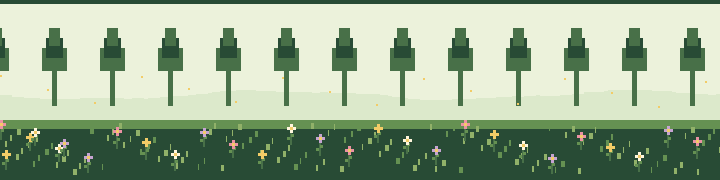

<!-- 🌿 FOREST GARDEN ANIMATION: keep forest-girl-loop.gif in this repository's root folder 🌷 -->

  

<h1 align="center">🌿 Bineta Saju 🌷</h1>

<em>Full-stack developer · AI explorer · Growing ideas into useful products</em>

🌱 Building with code · 🌼 Learning every day · 🌲 Growing through open source

---

## 🍃 A little about me

Hey! I'm **Bineta**, a Computer Science undergraduate and full-stack developer who enjoys turning ideas into practical applications.

- 🌿 Interested in AI-powered applications, full-stack development, and fintech.
- 🌷 Currently building **Billy**, an AI-powered bill-splitting mobile app.
- 🍄 Exploring Agentic AI, automation, and intelligent workflows.
- 🌱 Campus Lead at TinkerHub Foundation, supporting a community of 800+ tech learners.
- ☕ I believe the best way to learn is to build, experiment, and keep improving.

## 🌻 Things I've been growing

### 🌿 [Billy — AI-Powered Bill Splitting App](https://github.com/binetasaju/billy)

A mobile app in development that digitizes restaurant receipts using OCR and helps friends split expenses item by item.

- 📸 Receipt scanning and item extraction.
- 🧾 Item-level expense splitting and tax distribution.
- 👥 Payer management and contact integration workflows.

**Tech:** React Native · Expo · TypeScript · OCR

### 🍄 [SmartTask — AI-Driven Administrative Dashboard](https://github.com/binetasaju/Smart_Task)

A full-stack application that converts meeting audio into structured tasks using Deepgram and Gemini AI, with a React dashboard for task management.

- 🎙️ Meeting audio transcription.
- 🤖 AI-powered task extraction.
- 🗄️ Database-backed task management.

**Tech:** React · Node.js · Deepgram · Gemini AI · Neon PostgreSQL

### 🌼 [Image Search Website](https://github.com/binetasaju/mern-image-search)

A MERN-stack image discovery app using the Unsplash API, with responsive UI theming and personal image collections.

- 🔎 Real-time image search.
- 🎨 Dynamic UI theming.
- 🖼️ Personal image collection management.

**Tech:** React · Node.js · Express.js · MongoDB · Tailwind CSS

### 🌱 [Skill Tracker System](https://github.com/binetasaju/skill-tracker-final)

A web application for managing student skill records and validating teacher credentials, including certificate upload and verification.

**Tech:** HTML · CSS · JavaScript · SQLite

## 🌳 My developer toolkit

**Languages:** JavaScript · TypeScript · Python · C · SQL

**Frontend:** React.js · HTML · CSS · Tailwind CSS

**Backend & databases:** Node.js · PostgreSQL · MySQL · MongoDB · SQLite

**AI & automation:** Gemini AI · OCR · Deepgram · Automation Anywhere · UiPath

**Tools & design:** Git · GitHub · Figma · Canva

## 🌸 Beyond the code

### 🌿 Campus Lead — TinkerHub Foundation
*2025–2026*

- 🌱 Helped grow a technology-learning community of 800+ members.
- 🌷 Curated and led 32+ workshops on full-stack development, machine learning, Git, and open source.
- 🍃 Encouraged collaborative learning and experimentation.

### 🏆 A few milestones

- 🥇 First Prize — Logo Design, IEEE SB GECW.
- 🌼 Finalist — Lumira: “She Deserves Better,” IEEE WIE MITS.
- 🌿 Participated in the Indic Wikimedia Hackathon, Kochi.
- 🤖 Agentic AI internship at Finesse Direct, exploring RPA workflows and intelligent automation.

## 🍀 Currently growing

- 🌱 Building and refining Billy.
- 🌷 Deepening my full-stack and TypeScript skills.
- 🍄 Exploring practical AI and automation use cases.
- 🌳 Learning through projects, collaboration, and open source.

## 🌻 Let's connect

  <a href="https://www.linkedin.com/in/bineta-saju">LinkedIn</a> ·
  <a href="mailto:binetasaju@gmail.com">Email</a> ·
  <a href="https://github.com/binetasaju">GitHub</a>

<em>🌿 Keep growing. Keep building. Let your ideas bloom. 🌷</em>

